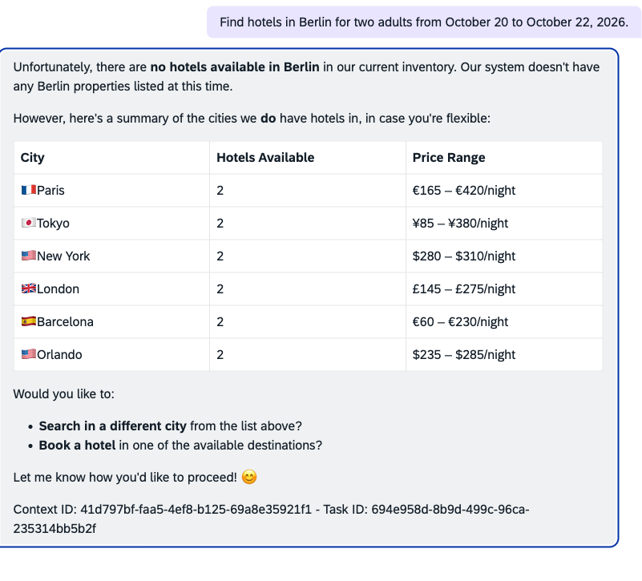

# Integrating XTravels with Joule

<style scoped>
  div[class*='language-']:has(code > .line:only-child) { overflow-y: hidden; }
  div[class*='language-']:has(code > .line:only-child) > button.copy { top: 50%; transform: translateY(-50%); }
</style>

This guide connects the IAS-protected XTravels hotel agent to a Joule tenant using the Agent-to-Agent (A2A) protocol, an SAP BTP destination, and a Joule capability.
{.abstract}

[[toc]]

Follows the [**Bring Your Own Agent**](https://architecture.learning.sap.com/docs/ref-arch/7b6426) reference architecture{.learn-more}

## Start with XTravels

Clone the CAP XTravels sample:

```zsh
git clone https://github.com/capire/xtravels
cd xtravels
```

The sample's [`HotelsService`](https://github.com/capire/xtravels/blob/main/srv/hotels/services.cds) is annotated with `@agent`, which exposes it through A2A.


::: tip Problems with `npm install`?
For installing the `@capire` packages, follow the sample's [GitHub Packages setup](https://github.com/capire/xtravels#using-github-packages).
:::

## Prerequisites

This guide assumes you already have an IAS tenant for your organization.

[Learn how to request tenant for SAP Cloud Identity Services](https://help.sap.com/docs/cloud-identity-services/cloud-identity-services/get-your-tenant){.learn-more}

### Register the IAS Tenant

In the **global account**…

::: tip Skip this if the IAS tenant is already listed under *System Landscape* → *Systems*.
:::

1. Choose **System Landscape** → **Systems** → **Service Owner View**.
2. Choose **Add** → **Add via CLD Discovery** → **Next Step**.
3. Select **System Type: SAP Cloud Identity Services** and enter its numeric **CLD Tenant ID**.
   Look it up under [**Working with SPC** → **Cloud Landscape Directory** → **Tenants**](https://spc.ondemand.com/)
   by the IAS URL or local tenant ID.
4. Choose **Next Step** → **Create**.

### Assign the Joule Entitlement

In the **provider subaccount**…

1. Choose **Entitlements** → **Edit** → **Add Service Plans**.
2. Select **Joule Development** → **standard (Application)**.
3. Select **Joule** → **designer**.
4. **Add 2 Service Plans** and **Save**.

### Subscribe to Joule in BTP

In the **provider subaccount**…

1. Choose **Services** → **Instances and Subscriptions** → **Create**.
2. Select **Service: Joule Development** and **Plan: standard**.
3. Choose **Create** and wait until the subscription status is **Subscribed**.

### Create the Formation

In the **global account**…

1. Choose **System Landscape** → **Formations** → **Create Formation**.
2. Enter a **Formation Name**, select **Formation Type: Integrate with Joule Development** → **Next Step**.
3. Select **Joule Dev** and the IAS system you registered before.
4. Choose **Next Step** → **Create** and wait until the formation is **Ready**.

### Install the CLIs

Install the Joule Studio CLI and the [SAP BTP CLI](https://help.sap.com/docs/btp/sap-business-technology-platform/download-and-start-using-btp-cli), then verify both:

```zsh
npm install -g @sap/joule-studio-cli
joule --version
btp --version
```

Create the Joule CLI service key in the target Cloud Foundry space:

```zsh
cf login --sso

cf create-service das-service-canary designer joule-designer --wait
cf create-service-key joule-designer joule-agent-cli --wait
```

### Assign the Compiler Role

In the **provider subaccount**…

1. Choose **Security** → **Role Collections** → **Create**, enter `Joule`, and choose **Create**.
2. Open **Joule** → **Edit** → **Show Value Help** next to **Role Name**.
3. Filter **Application Identifier** by the output of `cf service-key joule-designer joule-agent-cli | tail -n +2 | jq -r .credentials.uaa.xsappname`.
4. Select **capability_developer** → **Add** → **Save**.
5. Open **Users** → **Edit**, add your user from the IAS tenant, and choose **Save**.

## Create the Joule Capability

Configure IAS authentication and add a Joule capability to your CAP project:

```zsh
cds add joule
npm install
```

::: details Files generated by `cds add joule`

The command creates this structure in the CAP project:

```zsh
joule/
├── da.sapdas.yaml
└── xtravels-agent/
    ├── capability.sapdas.yaml
    ├── capability_context.yaml
    ├── functions/
    │   └── call_agent.yaml
    └── scenarios/
        └── invoke_agent.yaml
```

In `da.sapdas.yaml`, reference the local capability:

```yaml
schema_version: 1.9.0
name: xtravels_a2a
capabilities:
  - type: local
    name: xtravels_a2a
    folder: ./xtravels-agent
```

In `capability.sapdas.yaml`, map a system alias to the destination:

```yaml
schema_version: 3.32.0

metadata:
  namespace: com.sap.cap
  name: xtravels_a2a
  version: 1.0.0
  display_name: Xtravels Agent A2A Connector
  description: Connects the Xtravels Agent A2A agent to Joule.

system_aliases:
  XtravelsAgent:
    destination: XTRAVELS_A2A
```

Declare the A2A conversation identifiers in `capability_context.yaml`:

```yaml
variables:
  - name: contextId
  - name: taskId
```

In `functions/call_agent.yaml`, delegate the request to the remote agent and retain the A2A context for subsequent messages:

```yaml
parameters:
  - name: contextId
    optional: true
  - name: taskId
    optional: true

action_groups:
  - actions:
      - type: status-update
        message: <? "Invoking Xtravels Agent" ?>

      - type: agent-request
        agent_type: remote
        system_alias: XtravelsAgent
        body: >
          <? (contextId == null || contextId.isEmpty()) && (taskId == null || taskId.isEmpty())
             ? null
             : '{ "contextId": "' + contextId + '", "taskId": "' + taskId + '" }' ?>
        result_variable: result

      - type: set-variables
        variables:
          - name: contextId
            value: <? result.body.contextId ?>
          - name: taskId
            value: <? result.body.id ?>

      - type: message
        message:
          type: text
          content: "<? result.body.status.message.parts[0].text ?>"
          markdown: true

result:
  contextId: "<? contextId ?>"
  taskId: "<? taskId ?>"
```

Finally, map the context variables between the scenario and function in `scenarios/invoke_agent.yaml`. Make its description specific enough for Joule to select the agent for the intended requests:

```yaml
description: Delegate requests for Xtravels Agent to the remote CAP agent.

target:
  type: function
  name: call_agent
  parameters:
    - name: contextId
      value: $capability_context.contextId
    - name: taskId
      value: $capability_context.taskId

capability_context:
  - name: contextId
    value: $target_result.contextId
  - name: taskId
    value: $target_result.taskId
```

:::

## Deploy

Log in to the Joule Development tenant:

```zsh
joule login --sso --apiurl https://<joule-dev-system>
```

Deploy XTravels and its Joule capability:

```zsh
cds up
```

::: details What `cds up` does

1. Deploys XTravels to [Cloud Foundry](../deploy/to-cf) or [Kyma](../deploy/to-kyma).
2. Detects the generated `joule/da.sapdas.yaml` and reads its capability name.
3. Runs `joule deploy -c -n xtravels_a2a` from *./joule* to compile and deploy the capability.

:::

## Create the Destination

Log in to BTP and target the subaccount that contains the Cloud Foundry space:

```zsh
btp login
btp target --subaccount <subaccount-id>
```

Create an X.509 service key, upload its PEM key pair, and create the destination:

```zsh
cf create-service-key xtravels-ias joule-a2a-destination \
  -c '{"credential-type":"X509_GENERATED"}' --wait

(
  set -e
  umask 077
  key_store=$(mktemp -d)/xtravels-ias.pem
  trap 'rm -r "${key_store:h}"' EXIT

  cf service-key xtravels-ias joule-a2a-destination --json |
    jq -r '.credentials | .certificate, .key' > "$key_store"
  btp create connectivity/destination-certificate \
    --subaccount --file "$key_store"

  agent_url=$(
    cf curl "/v3/apps/$(cf app xtravels-srv --guid)/routes" |
      jq -r '[.resources[].url | select(contains(".cert.") | not)][0] |
        "https://\(.)/a2a/hotels"'
  )
  btp create connectivity/destination --subaccount --configuration "$(
    cf service-key xtravels-ias joule-a2a-destination --json |
      jq -c --arg url "$agent_url" --arg key_store "${key_store:t}" '{
        Name: "XTRAVELS_A2A",
        Type: "HTTP",
        ProxyType: "Internet",
        URL: $url,
        Authentication: "OAuth2ClientCredentials",
        clientId: .credentials.clientid,
        tokenServiceURL: (.credentials.url | rtrimstr("/")) + "/oauth2/token",
        tokenServiceURLType: "Dedicated",
        "tokenService.KeyStoreLocation": $key_store
      }'
  )"
)

btp get connectivity/destination --subaccount --name XTRAVELS_A2A
```

The subshell deletes the local PEM file even if a command fails. Never commit certificates or private keys.

## Launch and Verify

Launch the deployed assistant:

```sh
joule launch xtravels_a2a
```

Send a request that matches the scenario description, for example:

```text
Find hotels in New York for two adults
from October 20 to October 22, 2026.
```

Joule can now invoke the agent:



For productive use, repeat these steps with **Joule Production**.
